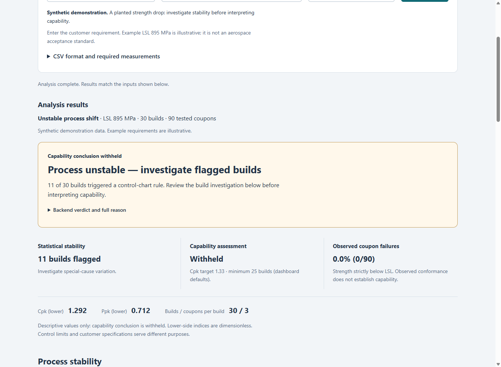

# AeroQual demonstration

**Demo site:** [https://zaurbabayev222.github.io/team-sigma/demo/](https://zaurbabayev222.github.io/team-sigma/demo/) (landing page: [index.html](index.html)), with the live app, a two-minute tryout, screenshots and how it works.

Examples are synthetic titanium coupon data for LPBF, WAAM, EB-PBF and powder-fed laser DED.
Each method has capable, incapable, unstable and inspection examples: sixteen datasets in total.
The original LPBF walkthrough is retained below, followed by extension evidence. The illustrative
lower strength limit is **895 MPa**, not a certified titanium requirement. Python calculates every
QC statistic; the dashboard displays its response. See [the data codebook](../data/README.md).

## Interactive HTML walkthrough

Open **[slidedeck/index.html](slidedeck/index.html)** in a browser. It is a self-contained file:
no installation, network connection or server is required for the lessons. If viewing on GitHub,
download the raw HTML first; GitHub's source preview does not execute the deck.

For an HTTP preview from the repository root:

```powershell
python -m http.server 8010 --bind 127.0.0.1 --directory demo/slidedeck
```

Open <http://127.0.0.1:8010>. The server serves only the artifact folder, not the repository.
The “Open local app” link expects a separately running dashboard at port **8001**. To use it:

```powershell
# Complete the root README setup first, then:
python -m uvicorn app.app:app --host 127.0.0.1 --port 8001
```

The root README's default port 8000 also works; open that URL manually if using it.
The deck is a captured training artifact, not a live API client or upload analyzer.
All analysis results come from the existing API; JavaScript only handles presentation and chart geometry.
CSV downloads reproduce the exact source files, with SHA-256 provenance in [deck-data.json](deck-data.json).

| Lessons | What to try |
| --- | --- |
| 1–3 | Understand the use case, choose four methods/four scenarios, inspect required/optional inputs |
| 4–5 | Separate stability/capability/failures; choose a build and inspect both control charts |
| 6–7 | Select signal/defect categories; compare denominators and blank versus `none` |
| 8–9 | Try full/single/range/empty date views; trace D024 to coupons and investigation checks |
| 10–11 | Compare captured LSL 895/925/980 outputs; download CSVs and reproduce in the actual app |
| 12–14 | Answer interpretation checks; inspect provenance and the open-ended remaining work |

Use the outline, Previous/Next, arrow keys, Page Up/Down or Home/End. Keyboard navigation leaves form
controls alone. “Print lessons” expands all 14 lessons for printing/PDF; interactive selections are
represented by their current training state. On mobile, expand the lesson outline as needed.

To refresh the artifact **after** starting an API built from the current sources and synced data:

```powershell
python demo/build_slidedeck.py --capture --base-url http://127.0.0.1:8001
python demo/build_slidedeck.py --check
python -m pytest tests/test_demo_artifact.py
```

Capture verifies all core fields against `app.qc.analyze`, records source/data hashes and embeds the
actual responses. `--check` detects stale sources or a stale generated file; it never contacts the API.
The artifact tests also check exact CSV bytes and unchanged control baselines in LSL/date experiments.
Screenshots: [desktop](screenshots/walkthrough-desktop.png), [mobile](screenshots/walkthrough-mobile.png).
The team reproduced the walkthrough on the live app on October 23, 2026.

## Verification status

The datasets and API are now present. The original three LPBF examples below were selected and analyzed in the running local AeroQual dashboard, with LSL **895 MPa**, a minimum of **25 builds** and Cpk target **1.33**. The tables record the numbers as displayed, including the dashboard's rounding. Each file contains **30 builds × 3 coupons = 90 coupons**, ordered B001–B030.

[results.json](results.json) captures the full-precision Python core results for all three datasets. The displayed outputs below were checked against those results. Independent teammate reproduction is still required before H-05 is formally complete; local verification is not evidence of a public deployment.

## Start and reproduce

Follow the [root setup instructions](../README.md#run-in-positron-on-windows-powershell). The built dashboard and API share port 8000. Keep the server running and open [AeroQual locally](http://127.0.0.1:8000/dashboard/).

Choose **Printing process: LPBF** for the original examples, then **Stable and capable**, **Stable but not capable**, or **Unstable process shift**. The underlying identifiers remain `stable_capable`, `stable_incapable`, and `unstable_shift`. Leave LSL at **895 MPa** and select **Analyze builds**. Alternatively upload the corresponding CSV from `data/`; use **Clear upload** to return to examples.

From a second Windows PowerShell terminal at the repository root:

```powershell
.\.venv\Scripts\python.exe demo/check.py --base-url http://127.0.0.1:8000
```

In Bash with the project environment active, use `python demo/check.py --base-url http://127.0.0.1:8000`. Omit `--base-url` for core-only checks. Add `--output demo/results.json` only when intentionally refreshing captured results after review; it overwrites that file.

The checker compares every core value, chart limit, build flag and reason. The expanded checker ends with `PASS: all six synthetic scenarios (LPBF + WAAM) and API parity.` No credentials are needed locally.

### Three-minute judging walkthrough

1. **Stable and capable:** identify 30 builds, 90 coupons and LSL 895 MPa in the result context. Show no flags, Cpk 1.683 and zero observed failures. Explain that the configured capability checks pass.
2. **Stable but not capable:** show no flags alongside 17/90 failures and Cpk 0.312. Explain that statistical stability and meeting the strength requirement are separate questions.
3. **Unstable process shift:** show 11 flagged builds, the withheld capability conclusion and 0/90 failures. Zero observed failures does not establish capability. Open the build investigation and compare the recorded oxygen values without claiming a proven cause.
4. Open **View all build data** to trace a plotted point to its numeric values and reason. Chart points also support keyboard focus. Inspect **Observed parameter reference ranges** and explain that these ranges come from unflagged builds, not qualified process windows.
5. Change LSL without analyzing: the previous result stays labeled with its original inputs and a refresh notice. Select **Analyze builds** to replace it. For your own CSV, open the format guidance before upload.

The page separates stability, capability and observed conformance. Diagnostic assumptions and the strength distribution table are expandable. Counts and control limits are unchanged by the presentation refinement.

## Observed summary

Cpk and Ppk are dimensionless lower-side indices. Sigma and chart limits are in MPa.

| Displayed output | `stable_capable.csv` | `stable_incapable.csv` | `unstable_shift.csv` |
| --- | ---: | ---: | ---: |
| Verdict | **capable** | **not capable** | **not assessable** |
| Cpk (lower) | 1.683 | 0.312 | 1.292 |
| Ppk (lower) | 1.789 | 0.331 | 0.712 |
| Failure rate | 0.0% (0/90) | 18.9% (17/90) | 0.0% (0/90) |
| Builds / coupons per build | 30 / 3 | 30 / 3 | 30 / 3 |
| Flagged builds | None | None | 11 (listed below) |
| Within-build sigma | 10.937 | 10.937 | 10.937 |
| Overall sigma | 10.292 | 10.292 | 19.859 |
| Shapiro–Wilk p-value | 0.8058 | 0.8058 | 0.0304 |

### Stable, capable

```bash
curl --fail 'http://127.0.0.1:8000/analyze?dataset=stable_capable&lsl=895'
```

Displayed reason: **“Cpk 1.68 is at or above the target 1.33.”** Both charts show no flagged builds, and no coupons are below the minimum.

**How to read this:** the stable synthetic process has enough distance above the customer minimum to meet the configured capability target.

### Stable, not capable

```bash
curl --fail 'http://127.0.0.1:8000/analyze?dataset=stable_incapable&lsl=895'
```

Displayed reason: **“Cpk 0.31 is below the target 1.33.”** Both charts show no flagged builds, but 17 of 90 coupons fall below the minimum.

**How to read this:** a process can be stable while consistently operating too close to the required minimum strength.

### Unstable shift

```bash
curl --fail 'http://127.0.0.1:8000/analyze?dataset=unstable_shift&lsl=895'
```

Displayed reason: **“Not assessable: process is unstable, builds out of control: B007, B014, B018, B020, B024, B025, B026, B027, B028, B029, B030.”**

**How to read this:** investigate the process change before interpreting capability. All 90 observed coupons exceed the LSL, but that does not establish capability for an unstable process. The lower Ppk and larger overall sigma reflect variation across the shifted log.

## Observed chart limits

| Dataset | X-bar LCL | X-bar center | X-bar UCL | S LCL | S center | S UCL |
| --- | ---: | ---: | ---: | ---: | ---: | ---: |
| `stable_capable.csv` | 931.292 | 950.236 | 969.179 | 0.000 | 9.693 | 24.892 |
| `stable_incapable.csv` | 886.292 | 905.236 | 924.179 | 0.000 | 9.693 | 24.892 |
| `unstable_shift.csv` | 918.459 | 937.402 | 956.345 | 0.000 | 9.693 | 24.892 |

X-bar monitors build means; S monitors within-build coupon spread. These statistical control limits are distinct from the customer LSL. Red points identify flagged builds; hover for the build ID, value and reason. A red build does not necessarily contain a failed coupon. Failures count coupons strictly below the LSL; a coupon equal to the LSL passes.

### Unstable example: flagged-build table

The stable examples display **“No builds flagged.”** The unstable example displays:

| Build | Date | Mean (MPa) | S (MPa) | Reason |
| --- | --- | ---: | ---: | --- |
| B007 | 2026-09-07 | 957.829 | 15.587 | mean above the X-bar upper limit |
| B014 | 2026-09-14 | 958.102 | 8.849 | mean above the X-bar upper limit |
| B018 | 2026-09-18 | 958.538 | 5.698 | mean above the X-bar upper limit |
| B020 | 2026-09-20 | 905.011 | 11.863 | mean below the X-bar lower limit |
| B024 | 2026-09-24 | 910.522 | 11.349 | mean below the X-bar lower limit |
| B025 | 2026-09-25 | 917.185 | 8.800 | mean below the X-bar lower limit |
| B026 | 2026-09-26 | 916.068 | 5.110 | mean below the X-bar lower limit |
| B027 | 2026-09-27 | 912.733 | 14.734 | mean below the X-bar lower limit |
| B028 | 2026-09-28 | 909.991 | 8.653 | mean below the X-bar lower limit |
| B029 | 2026-09-29 | 916.520 | 3.727 | mean below the X-bar lower limit |
| B030 | 2026-09-30 | 917.534 | 9.460 | mean below the X-bar lower limit |

The simulated strength drop and oxygen rise begin at **B020**. The current core estimates limits from the entire log, so the shifted grand mean also flags B007, B014 and B018 and does not flag every build after the change. Do not interpret those earlier flags as evidence that the planted change began earlier. All listed flags concern the build mean; none exceeds the S upper limit.

## Observed strength distribution

Each entry shows the displayed strength interval in MPa and its coupon count. These are rounded histogram boundaries, not specification thresholds; failures are determined from the original coupon strengths.

| Bin | Stable capable: interval / count | Stable incapable: interval / count | Unstable shift: interval / count |
| --- | --- | --- | --- |
| 1 | 927.302–933.577 / 3 | 882.302–888.577 / 3 | 895.238–905.521 / 6 |
| 2 | 933.577–939.852 / 14 | 888.577–894.852 / 14 | 905.521–915.805 / 11 |
| 3 | 939.852–946.128 / 13 | 894.852–901.128 / 13 | 915.805–926.088 / 12 |
| 4 | 946.128–952.403 / 21 | 901.128–907.403 / 21 | 926.088–936.371 / 9 |
| 5 | 952.403–958.678 / 22 | 907.403–913.678 / 22 | 936.371–946.654 / 15 |
| 6 | 958.678–964.954 / 10 | 913.678–919.954 / 10 | 946.654–956.938 / 20 |
| 7 | 964.954–971.229 / 5 | 919.954–926.229 / 5 | 956.938–967.221 / 13 |
| 8 | 971.229–977.504 / 2 | 926.229–932.504 / 2 | 967.221–977.504 / 4 |

Each distribution totals 90 coupons. The displayed Shapiro–Wilk p-value is 0.8058 in both stable examples and 0.0304 in the shifted example. A small p-value raises concern about normality; a large value does not prove it. Capability also requires stability and equal-size, time-ordered subgroups.

## Observed process parameters

The page's **“Usual range”** is the observed minimum–maximum among **unflagged builds**. It is not a qualified operating range. Because some changed builds remain unflagged, the unstable example's oxygen reference range includes elevated values.

| Parameter | Stable capable | Stable incapable | Unstable shift |
| --- | --- | --- | --- |
| Chamber oxygen (ppm) | 33.167–47.072 | 33.167–47.072 | 34.454–141.447 |
| Powder reuse (times) | 0.000–5.000 | 0.000–5.000 | 0.000–5.000 |
| Laser power (W) | 195.817–204.250 | 195.817–204.250 | 195.817–204.250 |

The stable examples have no flagged-build parameter rows. The unstable example displays these recorded values:

| Flagged build | Chamber oxygen (ppm) | Powder reuse (times) | Laser power (W) |
| --- | ---: | ---: | ---: |
| B007 | 38.774 | 0.000 | 199.215 |
| B014 | 46.303 | 1.000 | 199.883 |
| B018 | 33.167 | 5.000 | 198.842 |
| B020 | 141.926 | 1.000 | 200.804 |
| B024 | 138.497 | 5.000 | 202.561 |
| B025 | 143.933 | 0.000 | 199.948 |
| B026 | 137.093 | 1.000 | 198.500 |
| B027 | 140.228 | 2.000 | 198.736 |
| B028 | 147.072 | 3.000 | 198.026 |
| B029 | 142.306 | 4.000 | 198.831 |
| B030 | 136.907 | 5.000 | 200.894 |

Oxygen and strength were changed together by the synthetic generator. The comparison suggests where to investigate, but does not establish causation. The tool supports quality-engineering decisions and does not certify parts.

## Independent teammate reproduction

A teammate who did not write the demo must follow the commands above and record the date, commit or local revision, checker terminal output, and whether the dashboard matches all three cases. That independent human reproduction has not yet been recorded. The observations here are agent verification, not a substitute for that requirement.

## Frontend development checks

Run from the repository root after setup. In PowerShell use `npm.cmd` and `.\.venv\Scripts\python.exe`; in Bash use `npm` and the activated environment's `python`.

```bash
npm --prefix app/frontend ci --no-audit --no-fund
npm --prefix app/frontend test
npm --prefix app/frontend run build
```

Frontend tests use labeled fixtures and mocked HTTP responses to check rendering and API wiring. For the statistics and real HTTP API tests:

```bash
python -m pytest tests
```

## Submission evidence checklist

| Evidence | Current requirement |
| --- | --- |
| Working tool | Public app at https://connect.systems-apps.com/content/0639302d-988d-4820-961e-e3268e78b0b0/ (verified logged out) plus the local dashboard/API |
| Statistical correctness | Run the SPEC known-answer and degenerate tests; retain terminal output |
| Inputs and data | Three explicitly synthetic CSVs and the linked codebook with units and collection sources |
| Demonstration | Reproduce the three cases above and inspect the build evidence |
| Documentation | Follow root setup, input descriptions and API reference from a fresh clone |
| Independent reproduction | Done: team members reproduced the numbers on the live app (October 23, 2026) |
| Public submission | Logged-out access verified; Devpost entry links the repo, demo site and live app |

Synthetic examples illustrate software behavior and do not validate titanium manufacturing physics or qualify hardware.

## Local usability review captures

Captured from the running synthetic unstable scenario after the usability refinement, at LSL 895 MPa. These show local behavior, not a public deployment.



[Mobile assessment view](screenshots/mobile-review.png) (390 px viewport). Charts and wide data tables scroll inside their containers instead of expanding the page.

## WAAM walkthrough (H-10)

Select **Printing process: WAAM**, enter illustrative LSL **895 MPa**, and analyze each example. The original LPBF values above remain unchanged. Each WAAM example has 30 builds, 3 coupons per build, and 90 measurements. The process name and analyzed inputs appear above the results.

| WAAM example | Cpk (lower) | Ppk (lower) | Failures | Flagged builds | Verdict |
| --- | ---: | ---: | ---: | ---: | --- |
| Stable and capable | 1.911108 | 1.891083 | 0/90 | 0 | capable |
| Stable but not capable | 0.307909 | 0.304683 | 18/90 | 0 | not capable |
| Unstable process shift | 1.376709 | 0.579596 | 5/90 | 18 | not assessable |

For the unstable example, start with W020-W030 in **Build investigation**; full-log limits also flag W003, W004, W005, W010, W014, W016 and W017 before the planted shift. Arc current, voltage, wire-feed rate, travel speed and shielding-gas flow appear with their units. No laser or powder measurements are required. The strength drop and shielding-gas change are planted together from W020 and are not causal evidence. The codebook explains the seeded normal reference and independent arithmetic checks.

To upload an example, remain on WAAM and choose `data/waam_stable_capable.csv`. Wrong-profile tags or nonempty LPBF-only columns are rejected. Use **Clear upload** to return to examples. Switching back to LPBF clears the upload, refilters examples and marks any previous WAAM result stale. A generic measurement-only CSV relies on the user's selected process; it cannot identify the manufacturing method from strength values alone.

From PowerShell, with the app running:

```powershell
.\.venv\Scripts\python.exe data/generate_waam.py --check
.\.venv\Scripts\python.exe data/validate_waam.py
.\.venv\Scripts\python.exe demo/check.py --base-url http://127.0.0.1:8000
Invoke-RestMethod 'http://127.0.0.1:8000/analyze?dataset=waam_unstable_shift&lsl=895&process_type=waam'
```

The six-scenario checker compares every core field, including chart limits and all flags. The original results.json remains the historical LPBF capture; use results_waam.json for the WAAM full-precision capture. No hardware qualification or trained prediction is established by these examples. The WAAM revision is part of the deployed, team-checked app.

### WAAM local review captures

[Process selection](screenshots/waam-selection.png), [build investigation with WAAM units](screenshots/waam-investigation.png), and [mobile assessment](screenshots/waam-mobile.png) were captured from the running local synthetic examples. They are not evidence of a public WAAM deployment.

Local H-10 checks: 37 Python tests plus 8 subtests pass; 8 frontend tests and the build pass; both dataset validators and five bundle-contract tests pass. Browser checks cover all six scenarios, valid and mismatched uploads, stale process context, upload clearing, delayed catalog responses, keyboard inspection and mobile containment. The numerical engine in qc.py is unchanged. The dataset generators and manifests require no model training.


## H-11 to H-13: signal Pareto, investigation actions and four methods

The original LPBF/WAAM walkthrough and captures above remain historical evidence for their unchanged core outputs. The current local review build additionally supports EB-PBF and powder-fed laser DED, with three examples each. The normal quick-start server uses port 8000; the active parallel review preview uses **http://127.0.0.1:8001/dashboard/**. Stop or reuse the server deliberately rather than starting two on one port.

1. Select **EB-PBF**, then each of **Stable and capable**, **Stable but not capable** and **Unstable process shift**, with illustrative LSL 895 MPa. The corresponding Cpk/Ppk/failure/flag outcomes are below. No LPBF oxygen/laser fields are needed; EB-PBF labels and units come from its profile.
2. Repeat with **Laser DED**. In its unstable example, capability is withheld and the Pareto shows **16 signals across 15 flagged builds**: low mean 10 (62.5%), high mean 5 (31.25%) and high S 1 (6.25%). Cumulative percentages are 62.5%, 93.75%, 100%. D024 contributes to both low mean and high S. Signals are not physical defects or coupon failures.
3. Expand **Signal counts and affected builds** and verify IDs against the build table. The stable examples have no signal categories to rank. No-signal status alone does not establish capability.
4. Read **Recommended investigation actions**. Stable incapability prompts coupon-record review and qualified capability studies; instability prompts investigation before interpreting capability. Expand **More investigation checks** to see baseline, diagnostic and process-record checks; affected-build disclosures show the supporting IDs. These are checks, not causal diagnoses or numerical setpoint recommendations.
5. Upload `data/ebpbf_stable_capable.csv` under EB-PBF and `data/laser_ded_stable_capable.csv` under Laser DED. Compare with the builtins. Switch process and confirm the upload clears and the prior result is marked stale. Upload a tagged Laser DED CSV while EB-PBF is selected to verify a clear mismatch error.
6. On mobile, scroll within the Pareto/table region; the page itself should not overflow. Tab to the table region and inspect all rows. Dataset/file, selected process and LSL remain visible in the analyzed-input snapshot.

| Dataset | Cpk | Ppk | Failures / 90 | Flagged builds | Verdict |
| --- | ---: | ---: | ---: | ---: | --- |
| `ebpbf_stable_capable` | 2.542353 | 2.267525 | 0 | 0 | capable |
| `ebpbf_stable_incapable` | 0.402748 | 0.359211 | 16 | 0 | not capable |
| `ebpbf_unstable_shift` | 1.757831 | 0.535751 | 4 | 24 | not assessable |
| `laser_ded_stable_capable` | 1.394480 | 1.423374 | 0 | 0 | capable |
| `laser_ded_stable_incapable` | 0.231754 | 0.236557 | 22 | 0 | not capable |
| `laser_ded_unstable_shift` | 0.863484 | 0.444494 | 12 | 15 | not assessable |

Full-log limits can flag reference builds before the planted shifts. EB-PBF has 24 signals (13 high, 11 low); Laser DED has 16 (10 low, 5 high, 1 spread). The [codebook](../data/README.md#eb-pbf-and-powder-fed-laser-ded-h-13) explains seeds, exact affected IDs, shifts and independent arithmetic. Context associations are planted for demonstration, not validated physical effects. LSL 895 is illustrative for all examples.

Run from the repository root after setup (replace port for your running server):

```powershell
.\.venv\Scripts\python.exe data/validate_additional.py
.\.venv\Scripts\python.exe demo/check.py --base-url http://127.0.0.1:8001
Invoke-RestMethod 'http://127.0.0.1:8001/analyze?dataset=laser_ded_unstable_shift&lsl=895&process_type=laser_ded'
```

`results_extensions.json` captures actual API summaries, Pareto rows and investigation actions for all twelve scenarios at LSL 895, min_builds 25 and cpk_target 1.33. It is supporting evidence, not a replacement for running the app. Original result captures remain unchanged. New actual local captures: [desktop Pareto](screenshots/signal-pareto-laser-ded.png), [investigation actions](screenshots/investigation-actions.png), [mobile Pareto](screenshots/signal-pareto-mobile.png). These show a local build; the public app is verified separately (H-06).


## H-14: interactive Pareto and inspection demo

The previous twelve examples and evidence above remain available. Four separate **Inspection defect example** files add synthetic inspection classifications while preserving their source strength/settings. The current demonstration has sixteen runnable files, four per process. New actual API evidence is captured in `results_pareto.json` (all sixteen summaries and a one-day Laser DED view).

1. Open the local preview at **http://127.0.0.1:8001/dashboard/** (or port 8000 if using the standard launch). Choose **Laser DED > Inspection defect example**, illustrative LSL 895 MPa, and **Analyze builds**. Read the full-log withheld verdict, Cpk 0.863484, Ppk 0.444494, 12/90 strength failures and 15 flagged builds.
2. Read the signal Pareto: 16 occurrences on 15 builds, categories 10 low mean,5 high mean,1 high S. Read the separate inspection Pareto: 84/90 inspected,39 primary defects,45 explicit no-defect and6 unrecorded. Bars rank 20 Porosity,12 Lack of fusion,5 Cracking,2 Dimensional deviation; cumulative percentages 51.2821%,82.0513%,94.8718%,100%. The 80% reference is not a cause/severity claim.
3. Click or keyboard-activate **S above UCL**. The table narrows to D024, both full strength charts outline that build, and related checks cite its signal. The overall chart denominator remains 16. Expand **Coupon records for D024**: data rows70,71,72 have strengths843.895,892.535,956.666 MPa; their synthetic inspection results are unrecorded,Porosity,none respectively.
4. **Clear selection** restores flagged builds. Select **Porosity** using Enter or Space: 17 matching builds appear, including unflagged builds. The inspection denominator remains39; expand supporting counts/coupon rows and investigation checks. Recorded inspection defects and strength failures are distinct observations.
5. Set both date fields to **2026-10-24** and **Apply date range**. One of30 builds remains in the Pareto window, with two signals on one build (low mean and high S),50% each. Selecting high S keeps that denominator. Full-log control limits, Cpk/Ppk, failure totals and verdict remain unchanged.
6. Confirm a reversed date range produces an error and preserves the successful view; a future date range yields no builds without changing the full-log assessment. **Clear selection** keeps applied dates; **Reset Pareto view** clears both. Reanalyzing the dataset resets the view. Original LPBF fixtures cover different dates; use source dates rather than assuming October for all methods.
7. Upload `data/laser_ded_inspection_demo.csv` and repeat a date/category selection to exercise multipart fields. Repeat the other three process inspection examples; each has the same fixed category inventory but an independently shuffled coupon assignment. Switch processes and verify upload clearing/stale input behavior as before.
8. At mobile width, scroll inside the chart/table regions, activate a category by keyboard and inspect the exact-data table. Page-wide overflow should not occur. The table has a selected state, while the original red chart flags retain their meaning.

Actual local captures: [inspection chart](screenshots/pareto-expanded-inspection.png), [single-day selected signal](screenshots/pareto-expanded-signal.png), [selected coupon context](screenshots/pareto-expanded-builds.png), [mobile chart](screenshots/pareto-expanded-mobile.png). These are local evidence, not proof of deployment or independent teammate reproduction.

```powershell
.\.venv\Scripts\python.exe data/generate_inspection.py --check
.\.venv\Scripts\python.exe data/validate_inspection.py
.\.venv\Scripts\python.exe demo/check.py --base-url http://127.0.0.1:8001
```

See [the interaction/API guide](../docs/pareto-explorer.md) and [inspection codebook](../data/README.md#synthetic-inspection-examples-h-14) for missing/none semantics, percentage denominators, date validation and independent known-answer checks. No inspection category is inferred from strength and no printer setpoint recommendation is generated.
