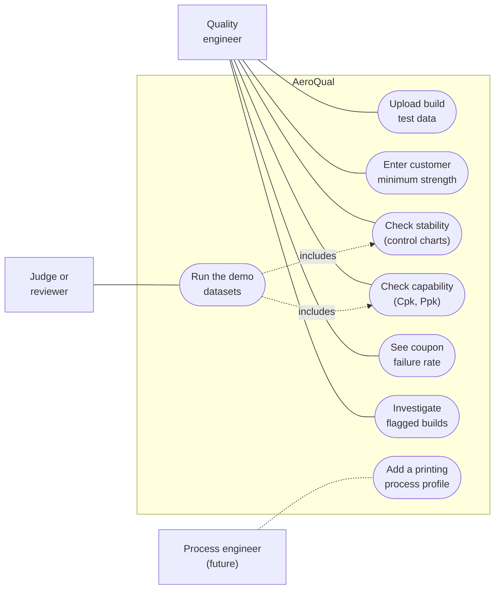
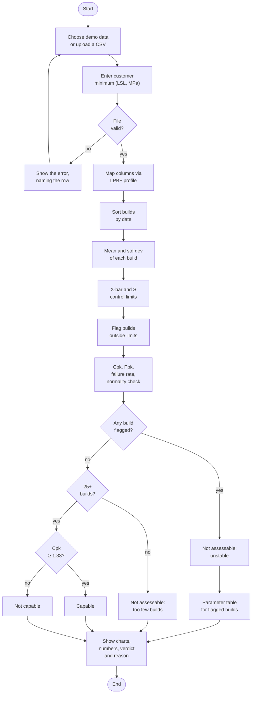
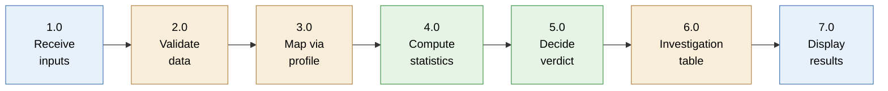
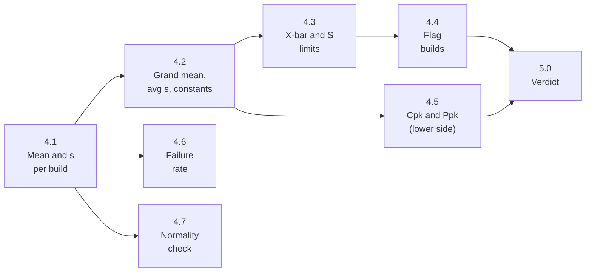
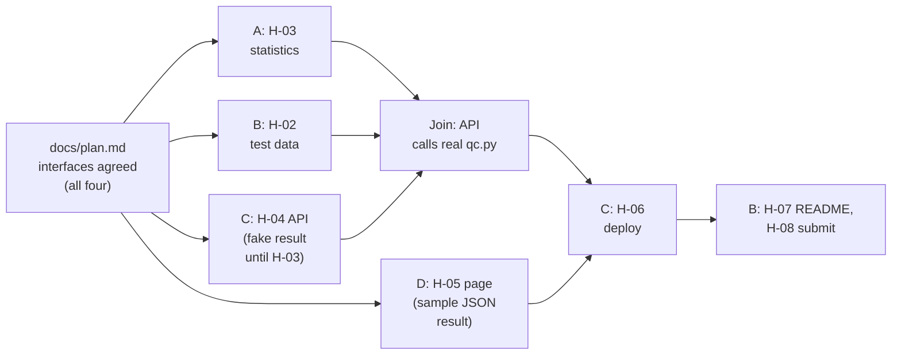

# How AeroQual works

Sigma Airlines · release 1 · 2026-10-19

Three pictures of the same app: who uses it ([use cases](#1-use-case-diagram)), what it does step by
step ([activity diagram](#2-activity-diagram)), and which function belongs to which subsystem
([FFBD](#3-functional-flow-block-diagram-ffbd)). The [subsystem table](#4-subsystems-and-who-builds-them)
maps each subsystem to a CONTRACT task and a teammate. Details live in [`SPEC.md`](../SPEC.md);
reasons in [`decisions.md`](decisions.md).

Each diagram has an image link under it, in case GitHub draws the Mermaid code badly. The images
are exported from the code: after editing a diagram, regenerate its image with
`npx -y @mermaid-js/mermaid-cli@11.4.2 -i <diagram>.mmd -o docs/images/diagram-<name>.png -b white -s 2`.

## 1. Use case diagram

[Open this diagram as an image](images/diagram-use-case.png)

The quality engineer is the one user release 1 is built for. Judges use the same page through the
demo datasets. Adding a process profile is a future use case (dashed); release 1 only makes it
cheap.

## 2. Activity diagram

[Open this diagram as an image](images/diagram-activity.png)

"File valid?" checks four things: the required columns are present, no `uts_mpa` is blank, every
build has the same number of coupons, and there are at least 2 builds. Every path ends with the
numbers on screen. Only the verdict changes, and it always says why.

## 3. Functional flow block diagram (FFBD)

Top level. Each block is a function; its colour is the subsystem that owns it (section 4).

[Open this diagram as an image](images/diagram-ffbd.png)

Blue = front end · amber = API and profile · green = statistics engine.

Function 4.0 broken down (all inside `app/qc.py`, no web code):

[Open this diagram as an image](images/diagram-ffbd-statistics.png)

The constants in 4.2 are c4, A3, B3 and B4, computed from the number of coupons per build. The
normality check in 4.7 is a Shapiro-Wilk test.

## 4. Subsystems and who builds them

| Subsystem | Functions | CONTRACT task | Files it owns | Teammate |
|---|---|---|---|---|
| Statistics engine | 4.0, 5.0 | H-03 | `app/qc.py`, `tests/` | A |
| Test data and codebook | test inputs for 1.0 | H-02 | `data/` | B |
| API and process profile | 2.0, 3.0, 6.0 | H-04 | `app/` except A's files | C |
| Front end and demo | 1.0, 7.0 | H-05 | `app/frontend/`, `demo/` | D |
| Deploy | public URL | H-06 | `.github/`, `app/manifest.json` | C |
| Docs and submission | README, repo check, Devpost | H-07, H-08 | `README.md`, `app/README.md`, `.gitignore` | B |

**The two interfaces everyone builds against**, agreed first and written in `docs/plan.md`:

1. **Data columns** (between B, C and A): `build_id`, `build_date`, `uts_mpa`, plus the optional
   LPBF parameters. SPEC section 3.
2. **What `qc.py` returns** (between A, C and D): one result object with the per-build points,
   the limits, Cpk, Ppk, the failure rate, the flags, the verdict and its reason. C passes it
   through the API as JSON; D draws it.

With those two fixed, all four can work at once:

[Open this diagram as an image](images/diagram-parallel-work.png)
