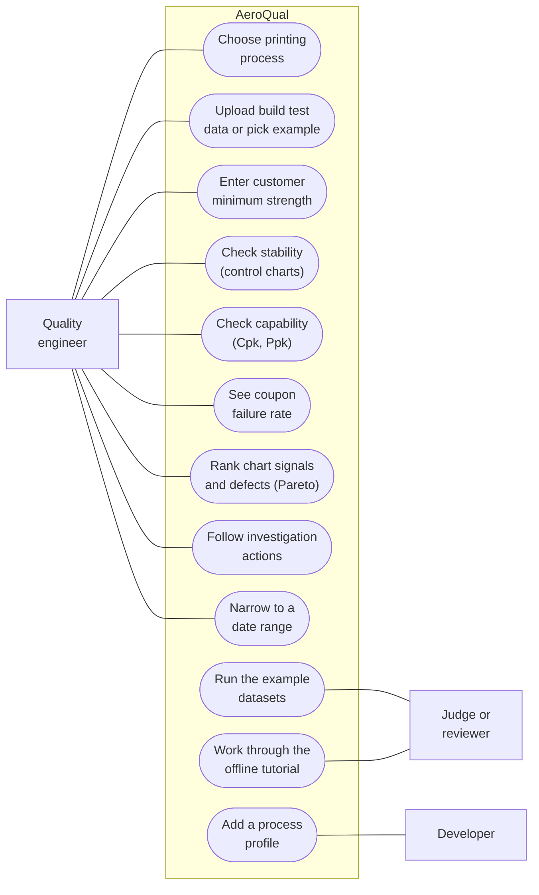
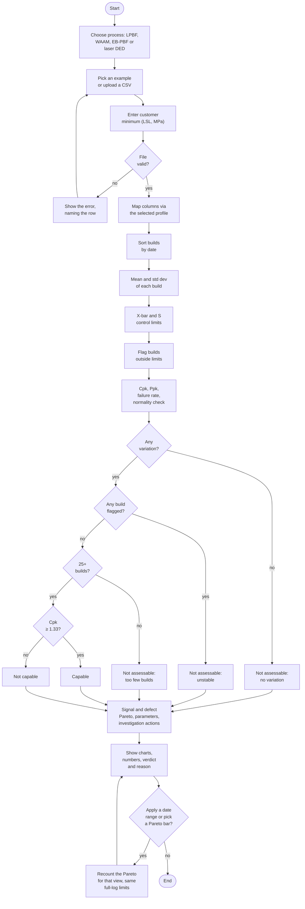
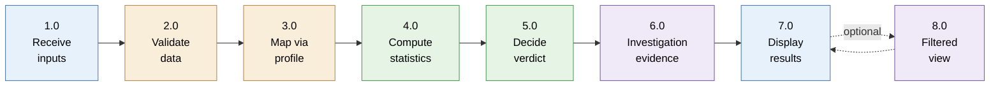
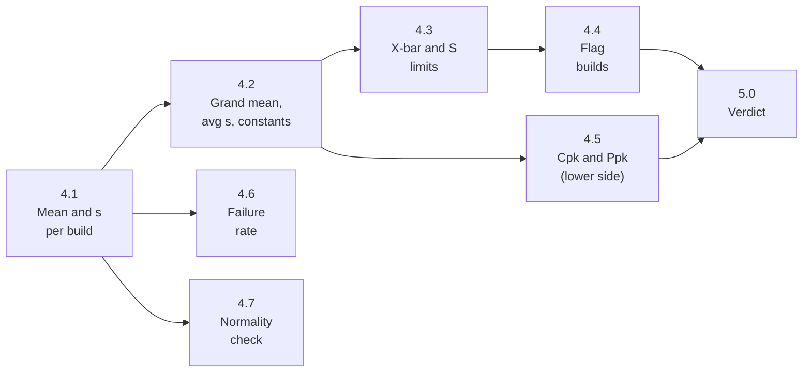
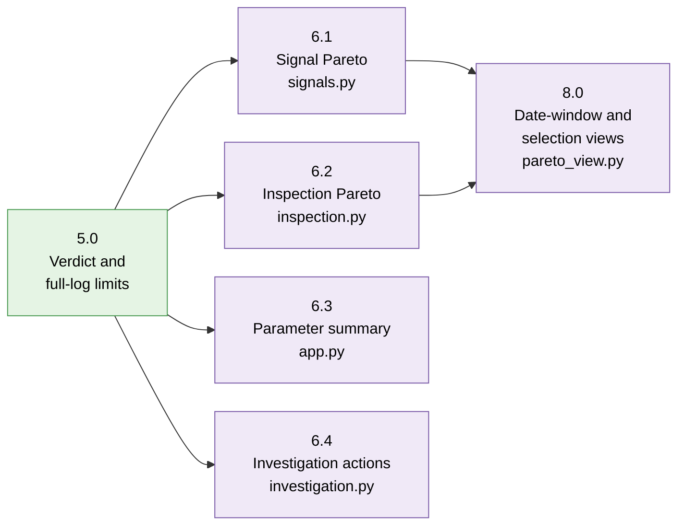
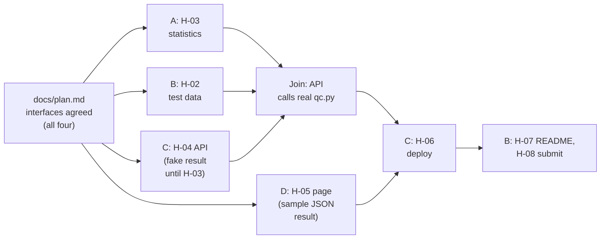

# How AeroQual works

Sigma Airlines · updated 2026-10-22 (release 1 plus the approved extensions H-10 to H-17)

Pictures of the same app: who uses it ([use cases](#1-use-case-diagram)), what it does step by
step ([activity diagram](#2-activity-diagram)), and which function belongs to which part of the code
([FFBD](#3-functional-flow-block-diagram-ffbd)). [Section 4](#4-subsystems)
maps each subsystem to its functions, CONTRACT tasks and files. Details live in
[`SPEC.md`](../SPEC.md); reasons in [`decisions.md`](decisions.md).

The [offline walkthrough](../demo/slidedeck/index.html) is a documentation artifact outside `app/`.
`demo/build_slidedeck.py` captures verified API outputs and exact synthetic CSVs into `deck-data.json`,
then inlines the template, styles, JavaScript and data into one HTML file. It has no external library,
network dependency or browser-side QC calculation. Actual uploads remain in the React/FastAPI app.
Current evidence and open release gates are in [evaluation.md](evaluation.md) and
[remaining-work.md](remaining-work.md).

Each diagram has an image link under it, in case GitHub draws the Mermaid code badly. The images
are exported from the code: after editing a diagram, regenerate its image with
`npx -y @mermaid-js/mermaid-cli@11.4.2 -i <diagram>.mmd -o docs/images/diagram-<name>.png -b white -s 2`.

## 1. Use case diagram

[Open this diagram as an image](images/diagram-use-case.png)

The quality engineer is the user the tool is built for. Judges use the same dashboard through the
example datasets, or the offline tutorial. A developer adds a printing process by writing one profile
file in `app/profiles/` and registering it; four exist (LPBF, WAAM, EB-PBF, powder-fed laser DED).

## 2. Activity diagram

[Open this diagram as an image](images/diagram-activity.png)

"File valid?" checks the required columns, that no `uts_mpa` is blank or non-numeric, that every
build has one date and the same number of coupons, that there are at least 2 builds, and that the
data match the chosen process. Every path ends with the numbers on screen. Only the verdict
changes, and it always says why. A date range or a Pareto selection changes only the investigation
view: limits, Cpk, Ppk and the verdict always come from the complete file.

## 3. Functional flow block diagram (FFBD)

Top level. Each block is a function; its colour is the part of the code that owns it.

[Open this diagram as an image](images/diagram-ffbd.png)

Blue = front end (`app/frontend/`) · amber = API and process profiles (`app/app.py`,
`app/profiles/`) · green = statistics engine (`app/qc.py`) · purple = descriptive investigation
helpers (plain Python, no new statistics).

Function 4.0 broken down (all inside `app/qc.py`, no web code):

[Open this diagram as an image](images/diagram-ffbd-statistics.png)

The constants in 4.2 are c4, A3, B3 and B4, computed from the number of coupons per build. The
normality check in 4.7 is a Shapiro-Wilk test.

Functions 6.0 and 8.0 broken down. They count and describe; they never change a limit or an index:

[Open this diagram as an image](images/diagram-ffbd-investigation.png)

## 4. Subsystems

| Subsystem | Functions | CONTRACT tasks | Main files |
|---|---|---|---|
| Statistics engine | 4.0, 5.0 | H-03, H-17 | `app/qc.py`, `tests/` |
| Investigation helpers | 6.0, 8.0 | H-11, H-12, H-14 | `app/signals.py`, `app/inspection.py`, `app/investigation.py`, `app/pareto_view.py` |
| Test data and codebook | test inputs for 1.0 | H-02, H-10, H-13, H-14 | `data/` |
| API and process profiles | 2.0, 3.0 | H-04, H-10, H-13 | `app/app.py`, `app/profiles/` |
| Front end and demo | 1.0, 7.0 | H-05, H-15, H-16 | `app/frontend/`, `demo/` |
| Deploy | public URL | H-06, H-09 | `.github/`, `app/manifest.json` |
| Docs and submission | README, repo check, Devpost | H-01, H-07, H-08 | `SPEC.md`, `PROJECT_OVERVIEW.md`, `README.md`, `app/README.md`, `docs/`, `.gitignore` |

**The two interfaces everyone built against**, agreed first and written in `docs/plan.md`:

1. **Data columns:** `build_id`, `build_date`, `uts_mpa`, plus the optional parameters of the
   selected process profile. SPEC section 3.
2. **What `qc.py` returns:** one result object with the per-build points, the limits, Cpk, Ppk,
   the failure rate, the flags, the verdict and its reason. The API adds the investigation helpers'
   output and passes it on as JSON; the front end draws it.

### Original work plan (Oct 19, historical)

Before anyone claimed tasks, the plan split the work into four parallel roles (A to D). Teammates
then claimed tasks freely, so the roles below do not show who did what; the Git history and
[`CONTRACT.yaml`](../CONTRACT.yaml) do.

[Open this diagram as an image](images/diagram-parallel-work.png)

## H-10 process selection

The browser loads GET /profiles and the selected process catalog from GET /datasets?process_type=.... Profile metadata supplies optional parameter names and units. GET /analyze uses a query parameter; POST /analyze uses a multipart process_type field. Both default to LPBF for older clients. profiles/__init__.py registers LPBF/WAAM and their six explicit example IDs. app.py validates process compatibility, passes only subgroup/order/value mappings into the unchanged qc.analyze function, and appends selected-profile context and histogram bins. No process-specific statistical engine is duplicated.

The upload snapshot includes process, dataset/file and LSL. Switching profiles clears an upload and marks older results stale. Example catalog cleanup ignores obsolete responses, so a delayed LPBF catalog cannot overwrite a WAAM selection. The deployment bundle includes both profile modules, registry and all six CSVs; isolated HTTP verification runs all six through demo/check.py.

## H-11 to H-13: signal and investigation flow

The API calls unchanged qc.analyze, then plain signals.signal_pareto and investigation.investigation_actions before serializing. React renders Python counts, percentages and action evidence; it computes only plot geometry/formatting. EB-PBF and powder-fed laser DED are registered profiles; dataset filtering, shared-field units and mismatch checks apply to all four. Twelve CSVs, both new helper modules and all four profile modules ship in the flat Connect bundle. See [the response contract](signal-investigation.md).

## H-14: fixed-limit investigation views

The API first performs complete-file analysis, then inspection_records/inspection_pareto and pareto_view produce read-only descriptive views. Filtering reuses original limits and includes inclusive source dates, scoped signal/inspection denominators, selected build/coupon context and focused actions. React submits the complete original dataset/file with optional view fields; no upload retention or database is added. A category selection narrows details, not the Pareto denominator. Four distinct synthetic inspection files supplement the unchanged twelve original CSVs. See [the view contract](pareto-explorer.md).
