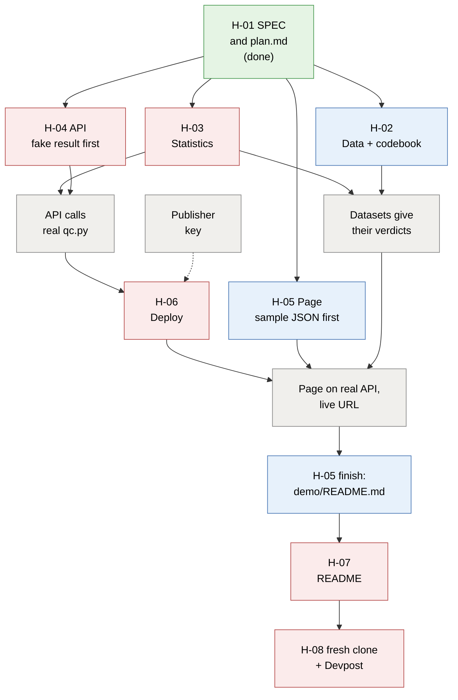

# Team guide: how we work

Sigma Airlines · AeroQual release 1 · written 2026-10-20

**Deadline: Friday Oct 23, 3 PM ET** on [Devpost](https://six-sigma-hackathon.devpost.com/). **Our own deadline is
Thursday Oct 22, 8 PM ET**: everything done and submitted, leaving Friday as a buffer.

**How this works:** nobody is pre-assigned. **Pick a task when you have time, and claim it in the team
chat before you start**, so nobody duplicates work. Zaur keeps going on the critical path and always
posts which task he is on now and which he will start next; leave those two to him. Every task has a
*start by* time: if it is still unclaimed then, whoever is free (usually Zaur) takes it, so the deadline
never depends on one person's busy week. Short on time? Take a 20-30 minute review instead.

The *what* is in [`SPEC.md`](../SPEC.md), the *how* in [`plan.md`](plan.md), the pictures in
[`architecture.md`](architecture.md), and the *why* in [`decisions.md`](decisions.md). Who has what
right now is always in [`CONTRACT.yaml`](../CONTRACT.yaml) (`status` and `owner` per task).

## The task tree

[Open this diagram as an image](images/diagram-task-tree.png) · Red = critical path · blue = runs
alongside · grey = a join point or input · green = done.

**Critical path:** H-03 → H-04 → H-06 → H-07 → H-08. A delay here delays the submission, so these
tasks have the tightest check-ins. H-02 and H-05 run alongside and block nobody.

| Wave | Starts when | Tasks (parallel within a wave) |
|---|---|---|
| 1 | now | H-03, H-02, H-04 (fake result), H-05 page (sample JSON) |
| 2 | H-03 done | H-04 joined to real `qc.py`; H-02 verdicts checked; H-06 deploy |
| 3 | H-04 and H-06 done | H-05 on the live API + `demo/README.md`; H-07 README |
| 4 | everything done | H-08 |

## Task board

All times ET. *Start by* = someone has claimed it in the chat and checked it out in `CONTRACT.yaml`
(`status: in_progress`, their name as owner). *Check-in* = the work so far is pushed and the chat knows
where it stands. Each task writes only to its own files, so people never step on each other.

| Task | What | Its files | Start by | Check-in | Done by | Size |
|---|---|---|---|---|---|---|
| H-03 | Statistics function and tests | `app/qc.py`, `app/requirements.txt`, `tests/` | Tue Oct 20, 9 PM | Wed Oct 21, 9 AM | Wed Oct 21, noon | ~4 h |
| H-02 | Three datasets + codebook | `data/` | Tue Oct 20, 9 PM | Wed Oct 21, 9 AM | Wed Oct 21, noon | ~3 h |
| H-04 | API + LPBF profile | `app/` (except H-03's files) | Tue Oct 20, 9 PM | Wed Oct 21, 9 AM | Wed Oct 21, 3 PM | ~4 h |
| H-05 | Page + demo walkthrough | `app/frontend/`, `demo/` | Wed Oct 21, 9 AM | Wed Oct 21, 3 PM | Thu Oct 22, noon | ~5 h |
| H-06 | Deploy to Posit Connect (repo owner) | `.github/`, `app/manifest.json` | Wed Oct 21, 3 PM | Wed Oct 21, 6 PM | Wed Oct 21, 9 PM | ~2 h |
| H-07 | README | `README.md`, `app/README.md` | Thu Oct 22, 9 AM | Thu Oct 22, noon | Thu Oct 22, 3 PM | ~2 h |
| H-08 | Fresh-clone check + Devpost | `.gitignore` | Thu Oct 22, 3 PM | Thu Oct 22, 5 PM | **Thu Oct 22, 8 PM** | ~1 h |

Who has what right now: `git pull`, then look at `status` and `owner` in `CONTRACT.yaml`, and at the
latest claims in the chat. H-06 needs the repo owner (Zaur) because only he can add the deploy secrets.

**Reviews** take 20-30 minutes each, and every task needs one before it counts as done. Any teammate
who did not build the task can do it; claim it in the chat like a task:

| Review | After | What you do |
|---|---|---|
| Statistics | H-03 | Read `app/qc.py` against SPEC §4; rerun the known-answer numbers |
| Datasets | H-02 | Open each CSV; check the columns, 3 coupons per build, the codebook |
| API numbers | H-04 | Run `testme`, call `/analyze` on one dataset, compare with H-03's numbers |
| Page | H-05 | Run each dataset on the page; compare the numbers with the API |
| Live tool | H-06 | Open the public URL logged out; run each dataset |
| README | H-07 | Follow it from a fresh clone, exactly as a judge would |

## Picking up a task

1. `git pull`. Check the chat and `CONTRACT.yaml`: pick a task that nobody has claimed, that is not
   Zaur's "now" or "next", and that the task tree says can start.
2. **Claim it in the chat:** "Taking H-02." First claim wins.
3. In Claude Code: `/superagent build H-02`. The agent marks it `in_progress` under your name. Let it
   commit and push that **first**, so everyone can see it in the repo too.
4. Work through the task's checklist below. Your agent asks before every commit.
5. **Push at least once by the check-in time**, even if it is not finished, and post one line on where
   you are ("H-02: two CSVs done, codebook next").
6. Out of time? Push what works, then tell the chat what is left. Unfinished is fine; silent is not.
7. Finished? Post "H-02 done, needs a review", and pick another task or a review if you have time.

## When a task stalls

- **Unclaimed at its start-by time:** whoever is free claims it in the chat as usual. Zaur takes it if
  nobody else does.
- **Claimed, but nothing pushed by its check-in:** someone asks in the chat, "Still on H-02? I can take
  it at 11 PM unless you say you're on it." The owner has **two hours** to reply.
- **No reply, or the owner says go ahead:** the new person changes `owner` in `CONTRACT.yaml` and carries
  on **from whatever was pushed**, never from scratch. The first owner can still review it or help.
- **Want to help on someone else's task?** Ask its owner first, then work only in the files they agree to.
- **Know early that you can't finish?** Say so in the chat as soon as you know. That is the most
  helpful thing you can do.

## Before you start (once)

1. Install **Python 3.12** (the version the FastAPI starter and the server use) and **Node.js LTS**
   (needed for H-05, and for the browser tool).
2. `git clone https://github.com/zaurbabayev222/team-sigma.git`, then `cd team-sigma`.
3. `claude`, then say **yes** to all three prompts: trust the folder, approve its tool servers, install
   its plugins. "playwright failed to connect" means Node is missing or Git Bash was not restarted.
4. Read [`SPEC.md`](../SPEC.md) sections 2-6 and the "Interfaces" section of [`plan.md`](plan.md).

## Rules for everyone

- **Claim before you build,** and push the claim first. One task at a time; `/clear` between tasks.
- **Stay in your task's files** (its `owns` list in `CONTRACT.yaml`). Need another file? Ask its owner.
- **`git pull` before every commit; push small and often.** On a conflict, ask your agent to resolve
  it and read what it did.
- **Read the diff before saying yes to a commit.** Say yes only if you understand it.
- **Never paste a key, password or server address into the chat or a file.**
- **"Done" means a command printed it.** Ask the agent for the real output, not "should work".
- **Interfaces in `plan.md` are frozen.** To change one, tell the whole team first.
- **Model:** `/model sonnet` to build (saves usage); `/model opus` if the agent is stuck.
- **Stuck** (a 429 error, a hang, the same error three times)? `/superagent I'm stuck: <error>`.

## Task checklists

### H-03 Statistics: `/superagent build H-03`

One plain, tested function, `analyze()` in `app/qc.py`, computes every number the tool shows.
Owns `app/qc.py`, `app/requirements.txt`, `tests/`.

- [ ] `pytest tests` passes.
- [ ] The SPEC §4 example reproduces: X̿ 1000, s̄ 10, X-bar limits 980.46-1019.54, S limits 0-25.68,
      Cpk 0.591, Ppk 0.571, failures 1/12, verdict "not assessable: too few builds".
- [ ] The same data with `min_builds=4` gives "not capable".
- [ ] Constant data gives `cpk` and `ppk` None and "not assessable: no variation" (never inf or 0).
- [ ] One build, unequal coupons per build, and a blank `uts_mpa` each raise a clear `ValueError`.
- [ ] c4, A3, B3, B4 are computed from n, not typed in; standard deviations use n − 1.
- [ ] No column names like `uts_mpa` inside `qc.py`: it stays generic.
- [ ] The stats-reviewer check (run in a fresh session) reports PASS.

### H-02 Data and codebook: `/superagent build H-02`

Three seeded CSVs in `data/` (`stable_capable.csv`, `stable_incapable.csv`, `unstable_shift.csv`),
each 30 builds × 3 coupons, plus `data/README.md`. Owns `data/`.

- [ ] Exactly the columns in `plan.md` Interfaces item 1; one row per coupon; dates in order.
- [ ] Every build has 3 coupons; no blank `uts_mpa`; values roughly 900-1100 MPa; LSL 895 MPa.
- [ ] Running the generator again gives identical files (fixed seeds).
- [ ] `unstable_shift.csv`: chamber oxygen rises from build 20 and strength drops with it.
- [ ] `data/README.md` covers every file and every column with units, how the data would be collected
      for real, and says **synthetic**.
- [ ] Once H-03 is in: each file gives its intended verdict.

### H-04 API and profile: `/superagent build H-04`

`demos/fastapi` copied to `app/`, the LPBF profile, and the routes in `plan.md` Interfaces item 3. Use a
fake result with the plan's exact keys until H-03 is merged. Owns `app/` except H-03's files.

- [ ] `testme` starts the API with one command.
- [ ] `curl` on `/health` and on `/analyze` for one dataset returns H-03's numbers exactly.
- [ ] A bad CSV returns HTTP 400 with the error message, not a crash.
- [ ] No statistics in the API code: it only calls `analyze()`.
- [ ] Every import is in `app/requirements.txt` (agree it with whoever has H-03).
- [ ] The datasets will be on the server, not only in `data/` (plan risk 3).

### H-06 Deploy: `/superagent build H-06`

As soon as H-04 runs locally. Owns `.github/`, `app/manifest.json`.

- [ ] `CONNECT_SERVER` and `CONNECT_API_KEY` are GitHub repo secrets (Settings → Secrets and variables →
      Actions). Never in a file or the chat.
- [ ] The GitHub Actions deploy run is green.
- [ ] The public URL answers in a logged-out browser with the same numbers.
- [ ] The live URL is posted in the team chat.

### H-05 Page and demo: `/superagent build H-05`

`demos/reactfront` copied to `app/frontend/` with its browser-side `spc.js` maths removed; draws from
a sample JSON with the plan's exact keys until the API is ready. Owns `app/frontend/`, `demo/`.

- [ ] No statistic is computed in JavaScript; every number comes from the API.
- [ ] Dataset picker and LSL input; X-bar and S charts with flagged builds in red; Cpk, Ppk, failure
      rate, verdict and reason; parameter table; a **SYNTHETIC DEMO DATA** banner.
- [ ] Units (MPa) on axes and numbers.
- [ ] Works with the real API, locally and at the live URL; the agent showed you a screenshot.
- [ ] `demo/README.md` gives, per dataset, the steps, the numbers shown and one line on how to read
      them. A teammate following it gets the same numbers.
- [ ] Styling only after the numbers show correctly.

### H-07 README: `/superagent build H-07`

Once the tool is live. Owns `README.md`, `app/README.md`.

- [ ] Says what the tool does, for whom, every input, how to run it in one command, the live URL, and
      links `demo/README.md`.
- [ ] Someone who did not write it followed it from a fresh clone without help.

### H-08 Submit: `/superagent build H-08`

Thursday afternoon. Owns `.gitignore`.

- [ ] A fresh clone into an empty folder runs `testme` and `pytest tests` with no extra steps.
- [ ] `git grep -i "api_key"` finds no real key.
- [ ] Devpost entry submitted with the repo link and demo, **by Thursday 8 PM ET**.
